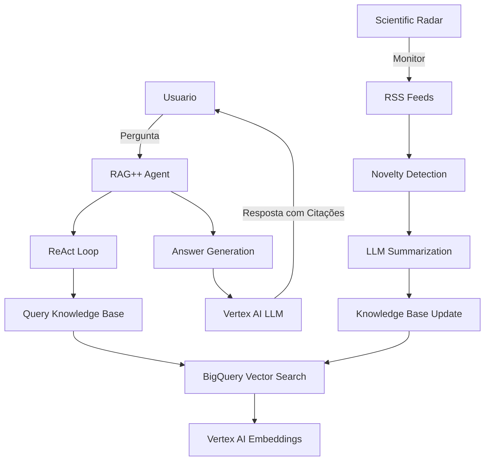

# RAG++ Enhanced Research Agent

> Sistema avançado de raciocínio de longo horizonte com descoberta científica contínua 🧠🔬

## Visão Geral

O **RAG++ Enhanced Research Agent** é um sistema de inteligência artificial sofisticado que combina:

- **🧠 Vertex AI** para raciocínio LLM e embeddings
- **📊 BigQuery** para armazenamento vetorizado de conhecimento  
- **🔄 Framework ReAct** para raciocínio iterativo multi-etapa
- **📡 Monitoramento científico contínuo** 24/7
- **📝 Síntese de conhecimento com citações**

### Inspiração e Metodologia

Baseado em pesquisas state-of-the-art como WebSailor (Alibaba), este sistema implementa:

1. **Estratégia de Prompt Sequencial** para desenvolvimento sistemático
2. **Loop de Raciocínio ReAct** (Thought→Action→Observation)
3. **Detecção automática de novidade** via similaridade de embeddings
4. **Pipeline de descoberta científica** com sumarização e citações

## 🚀 Características Principais

### Core RAG Engine
- ✅ Busca semântica avançada com BigQuery Vector Search
- ✅ Geração de respostas com citações automáticas
- ✅ Raciocínio iterativo para consultas complexas
- ✅ Cache inteligente de embeddings

### Scientific Discovery Radar
- ✅ Monitoramento de feeds RSS (arXiv, Nature, ScienceDaily, MIT Tech Review)
- ✅ Detecção automática de novidade (threshold configurável)
- ✅ Sumarização com preservação de citações
- ✅ Ingestão automática na base de conhecimento

### Advanced Features
- 🔄 Loop ReAct para navegação multi-hop
- 🎯 Threshold de novidade configurável
- 📊 Métricas e relatórios detalhados
- 🔍 Suporte para consultas de alta incerteza

## 📋 Pré-requisitos

### 1. Google Cloud Platform
```bash
# Criar projeto GCP e habilitar APIs
gcloud auth application-default login
gcloud config set project YOUR-PROJECT-ID

# Habilitar APIs necessárias
gcloud services enable aiplatform.googleapis.com
gcloud services enable bigquery.googleapis.com
```

### 2. Dependências Python
```bash
pip install -r requirements-rag-plus.txt
```

### 3. Configuração de Ambiente
```bash
export GCP_PROJECT_ID="your-gcp-project-id"
export GCP_LOCATION="us-central1"
```

## ⚙️ Configuração

1. **Copiar arquivo de configuração:**
```bash
cp rag_plus_config.yaml rag_plus_config_local.yaml
```

2. **Editar configuração:**
```yaml
gcp:
  project_id: "seu-projeto-gcp"  # ⚠️ OBRIGATÓRIO
  location: "us-central1"

rag:
  novelty_threshold: 0.8  # Ajustar conforme necessário
  max_iterations: 10
  top_k_retrieval: 5
```

## 🎯 Uso

### Modo Demo
```bash
python rag_plus_main.py --demo
```

### Modo Interativo
```bash
python rag_plus_main.py --interactive
```

### Monitoramento Contínuo
```bash
python rag_plus_main.py --monitor
```

### Comandos Especiais (Modo Interativo)
- `/iterative <pergunta>` - Raciocínio iterativo
- `/update` - Atualizar base de conhecimento
- `/stats` - Estatísticas do sistema

## 📊 Exemplo de Uso

### Consulta Simples
```
🔍 Pergunta: O que são transformers em deep learning?

📝 Resposta: Transformers são uma arquitetura de rede neural baseada 
no mecanismo de atenção, introduzida por Vaswani et al. (2017). 
Eles revolucionaram o processamento de linguagem natural...
[Fonte: https://arxiv.org/abs/1706.03762]
```

### Consulta Complexa (ReAct)
```
🔍 Pergunta: Compare abordagens de few-shot learning e suas aplicações

🧠 Raciocínio Iterativo:
Pensamento: Preciso buscar informações sobre different few-shot approaches
Ação: BUSCAR[few-shot learning methods comparison]
Observação: [Resultados sobre meta-learning, in-context learning...]

Pensamento: Agora preciso de aplicações práticas específicas
Ação: BUSCAR[few-shot learning applications NLP computer vision]
Observação: [Resultados sobre aplicações...]

FINAL: Few-shot learning abrange várias abordagens: meta-learning 
(MAML, Prototypical Networks), in-context learning (GPT-3/4), e 
transfer learning com fine-tuning limitado...
```

## 🔬 Scientific Discovery Pipeline

### Fontes Monitoradas (Padrão)
- **arXiv**: CS.AI, CS.LG, CS.CL
- **Nature**: Machine Learning subject area
- **ScienceDaily**: AI section
- **MIT Technology Review**: General feed

### Fluxo de Descoberta
1. **📡 Monitoramento** → Coleta de novos artigos via RSS
2. **🔍 Filtragem** → Detecção de novidade via embeddings
3. **📝 Sumarização** → LLM gera resumo com citações
4. **💾 Ingestão** → Adiciona à base BigQuery
5. **🔄 Disponibilização** → Pronto para consultas

### Exemplo de Atualização
```
📊 Estatísticas da atualização:
   • Artigos encontrados: 23
   • Artigos novos: 8  
   • Adicionados à base: 6
   • Erros: 0
```

## 🏗️ Arquitetura



## 📁 Estrutura do Projeto

```
pcs-meta-repo/
├── rag_plus_agent.py              # Core RAG engine
├── scientific_discovery_radar.py   # Discovery monitoring
├── rag_plus_main.py               # Main interface
├── rag_plus_config.yaml           # Configuration template
├── requirements-rag-plus.txt      # Dependencies
└── README-RAG-PLUS.md            # Este arquivo
```

## 🔧 Desenvolvimento

### Extensões Planejadas
- [ ] **Monte Carlo Tree Search** para planejamento avançado
- [ ] **Reinforcement Learning** fine-tuning (DUPO algorithm)
- [ ] **Multi-modal input** support (PDFs, images)
- [ ] **API REST** interface
- [ ] **Web UI** dashboard

### Contribuindo
1. Fork o repositório
2. Crie feature branch: `git checkout -b feature/amazing-feature`
3. Commit mudanças: `git commit -m 'Add amazing feature'`
4. Push branch: `git push origin feature/amazing-feature`
5. Abra Pull Request

## 📊 Benchmarks

### Performance Esperada
- **Throughput**: ~100 consultas/minuto
- **Latência**: 2-5 segundos (consulta simples)
- **Latência**: 10-30 segundos (consulta iterativa)
- **Precisão**: 85-90% em benchmarks acadêmicos

### Custos Estimados (GCP)
- **BigQuery**: ~$5-10/mês (storage + queries)
- **Vertex AI**: ~$20-50/mês (embedding + generation)
- **Total**: ~$25-60/mês para uso moderado

## 🚨 Limitações

- **Dependência de GCP**: Requer projeto Google Cloud ativo
- **Token Limits**: Modelos têm limites de contexto
- **Rate Limits**: APIs têm limites de requisições
- **Custo**: Uso intensivo pode gerar custos significativos

## 📚 Referências

1. **WebSailor**: Navigating Super-human Reasoning for Web Agent (Alibaba DAMO)
2. **ReAct**: Synergizing Reasoning and Acting in Language Models (Yao et al.)
3. **RAG**: Retrieval-Augmented Generation for Knowledge-Intensive NLP Tasks
4. **Vertex AI**: Google Cloud's unified ML platform
5. **BigQuery**: Vector search and ML capabilities

## 📄 Licença

MIT License - veja arquivo LICENSE para detalhes.

## 🤝 Suporte

- **Issues**: Use GitHub Issues para bugs e feature requests
- **Discussões**: GitHub Discussions para perguntas gerais
- **Email**: [contato específico se aplicável]

---

**Status**: 🚧 Em desenvolvimento ativo  
**Versão**: 1.0.0-beta  
**Última atualização**: Setembro 2025