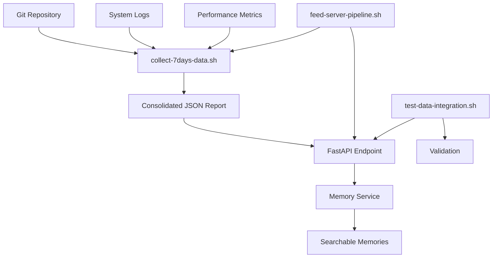

# Sistema de Análise e Alimentação de Dados - 7 Dias

> Sistema automatizado para coleta, análise e integração de dados operacionais dos últimos 7 dias no servidor RAG++.

## 📋 Visão Geral

Este sistema foi desenvolvido para **alimentar o servidor RAG++ com dados históricos dos últimos 7 dias**, incluindo mudanças no código, logs do sistema, métricas de performance, análise de erros e configurações. O objetivo é fornecer contexto histórico para melhor tomada de decisões e insights operacionais.

## 🏗️ Arquitetura do Sistema



## 📁 Componentes do Sistema

### 1. Script de Coleta de Dados (`collect-7days-data.sh`)

**Localização**: `/ops/collect-7days-data.sh`

**Função**: Coleta dados dos últimos 7 dias de múltiplas fontes:

- **Git Changes**: Histórico de commits, estatísticas de desenvolvimento
- **System Logs**: Logs nginx, cloudflared, systemd journals
- **Performance Metrics**: CPU, memória, disco, uptime
- **Error Analysis**: Padrões de erro, frequência, severidade
- **Config Changes**: Modificações em arquivos de configuração
- **Consolidated Report**: Resumo executivo com métricas principais

**Funcionalidades**:
- ✅ Coleta automática de 6 categorias de dados
- ✅ Geração de relatório consolidado em JSON
- ✅ Análise de tendências e padrões
- ✅ Detecção de anomalias e alertas
- ✅ Estrutura de dados padronizada

### 2. Endpoint do Servidor (`ragpp_web_server.py`)

**Localização**: `/ragpp/ragpp_web_server.py`

**Endpoint**: `POST /admin/feed-analysis-data`

**Função**: Recebe e processa dados de análise dos últimos 7 dias:

- **Parsing**: Extrai e valida dados do relatório consolidado
- **Processing**: Analisa e categoriza informações por tipo e importância
- **Storage**: Armazena múltiplas memórias no sistema de memória
- **Indexing**: Cria índices pesquisáveis para recuperação futura

**Tipos de Memória Criados**:
- `system_analysis`: Resumo executivo geral
- `system_health`: Status de conectividade e serviços
- `development_activity`: Atividade de commits e desenvolvimento
- `error_analysis`: Análise de erros e problemas detectados
- `raw_analysis_data`: Dados brutos para referência futura

### 3. Script de Teste de Integração (`test-data-integration.sh`)

**Localização**: `/ops/test-data-integration.sh`

**Função**: Testa a integração completa do sistema:

1. ✅ Verifica pré-requisitos e dependências
2. ✅ Testa conectividade com o servidor
3. ✅ Executa coleta de dados
4. ✅ Valida estrutura dos dados gerados
5. ✅ Envia dados para o endpoint
6. ✅ Verifica armazenamento na memória
7. ✅ Gera relatório de validação

### 4. Pipeline Principal (`feed-server-pipeline.sh`)

**Localização**: `/ops/feed-server-pipeline.sh`

**Função**: Executa o pipeline completo de alimentação:

1. 🚀 Verifica status do servidor RAG++
2. 📊 Executa coleta de dados dos últimos 7 dias
3. 🔄 Alimenta o servidor com dados coletados
4. ✅ Verifica integração dos dados
5. 🧹 Limpa arquivos temporários
6. 📋 Gera resumo de execução

## 🚀 Como Usar

### Execução Rápida (Pipeline Completo)

```bash
# Executar pipeline completo
cd /home/agourakis82/workspace/pcs-meta-repo
./ops/feed-server-pipeline.sh

# Com opções
./ops/feed-server-pipeline.sh --no-cleanup  # Manter arquivos temporários
./ops/feed-server-pipeline.sh --server-url http://localhost:8080
```

### Execução por Etapas

```bash
# 1. Apenas coleta de dados
./ops/feed-server-pipeline.sh --collect-only

# 2. Apenas teste de integração
./ops/feed-server-pipeline.sh --test-only

# 3. Coleta manual + análise
./ops/collect-7days-data.sh
./ops/test-data-integration.sh --no-cleanup
```

### Verificação Manual

```bash
# Verificar saúde do servidor
curl http://127.0.0.1:8000/health

# Buscar dados na memória
curl "http://127.0.0.1:8000/memory/search?query=análise+sistema+7+dias"

# Verificar dados brutos (se --no-cleanup usado)
ls -la /tmp/pcs-7days-analysis/
cat /tmp/pcs-7days-analysis/consolidated-report.json | jq .
```

## 📊 Estrutura dos Dados

### Relatório Consolidado (JSON)

```json
{
  "report_metadata": {
    "generated_at": "2024-01-15T10:30:00Z",
    "hostname": "DemetriosPCS",
    "period_days": 7,
    "system_info": {
      "os": "Linux",
      "kernel": "6.5.0",
      "uptime": "2 days, 14:30"
    }
  },
  "executive_summary": {
    "total_commits_period": 15,
    "nginx_errors_period": 3,
    "services_status": {
      "all_services_running": 3
    },
    "connectivity_health": {
      "external_api_accessible": true,
      "internal_api_accessible": true
    }
  },
  "data_files": [
    "/tmp/pcs-7days-analysis/git-changes.json",
    "/tmp/pcs-7days-analysis/system-logs.json",
    "/tmp/pcs-7days-analysis/performance-metrics.json",
    "/tmp/pcs-7days-analysis/error-analysis.json",
    "/tmp/pcs-7days-analysis/config-changes.json"
  ]
}
```

### Memórias Geradas no Servidor

| Tipo | Importância | Tags | Conteúdo |
|------|-------------|------|----------|
| `system_analysis` | 0.8 | system, 7days, analysis | Resumo executivo completo |
| `system_health` | 0.7 | connectivity, health, services | Status APIs e serviços |
| `development_activity` | 0.6 | git, commits, development | Atividade de desenvolvimento |
| `error_analysis` | 0.7-0.9 | nginx, errors, monitoring | Análise de erros detectados |
| `raw_analysis_data` | 0.5 | raw_data, reference, backup | Dados brutos para referência |

## 🔧 Configuração e Dependências

### Pré-requisitos do Sistema

```bash
# Ferramentas essenciais
sudo apt update
sudo apt install -y curl jq git python3 python3-pip

# Para servidor RAG++
pip install fastapi uvicorn pydantic

# Para logs do sistema (opcional)
sudo apt install -y systemd
```

### Configuração do Servidor

```bash
# Iniciar servidor RAG++ manualmente
cd /home/agourakis82/workspace/pcs-meta-repo
uvicorn ragpp.ragpp_web_server:app --host 127.0.0.1 --port 8000

# Ou usar o pipeline (inicia automaticamente se necessário)
./ops/feed-server-pipeline.sh
```

### Variáveis de Ambiente (Opcionais)

```bash
# URL do servidor
export RAGPP_SERVER_URL="http://127.0.0.1:8000"

# Diretório temporário personalizado
export TEMP_DATA_DIR="/custom/path/analysis"

# Período de análise personalizado (dias)
export ANALYSIS_PERIOD_DAYS=14
```

## 📈 Monitoramento e Logs

### Logs do Sistema

```bash
# Logs do pipeline
tail -f /tmp/ragpp-server.log

# Logs de coleta de dados
./ops/collect-7days-data.sh 2>&1 | tee /tmp/collection.log

# Logs de integração
./ops/test-data-integration.sh 2>&1 | tee /tmp/integration.log
```

### Métricas de Execução

| Métrica | Local | Descrição |
|---------|-------|-----------|
| Tempo de coleta | Terminal output | Tempo para coletar todos os dados |
| Tamanho dos dados | `/tmp/pcs-7days-analysis/` | Volume de dados coletados |
| Memórias criadas | Response JSON | Número de memórias armazenadas |
| Taxa de sucesso | HTTP status | Status da integração |

## 🛠️ Troubleshooting

### Problemas Comuns

**1. Servidor não responde**
```bash
# Verificar se está rodando
ps aux | grep uvicorn

# Verificar porta
netstat -tulpn | grep 8000

# Iniciar manualmente
uvicorn ragpp.ragpp_web_server:app --host 127.0.0.1 --port 8000
```

**2. Falha na coleta de dados**
```bash
# Verificar permissões
ls -la /var/log/nginx/
sudo chmod +r /var/log/nginx/*.log

# Testar comando git
git log --oneline --since="7 days ago"
```

**3. Erro de JSON inválido**
```bash
# Validar JSON gerado
cat /tmp/pcs-7days-analysis/consolidated-report.json | jq .

# Verificar encoding
file /tmp/pcs-7days-analysis/*.json
```

**4. Memórias não encontradas**
```bash
# Aguardar indexação (pode levar alguns segundos)
sleep 10

# Buscar com query diferente
curl "http://127.0.0.1:8000/memory/search?query=sistema"

# Verificar endpoint diretamente
curl -X POST "http://127.0.0.1:8000/admin/feed-analysis-data" \
  -H "Content-Type: application/json" \
  -d '{"test": true}'
```

## 🔐 Segurança e Boas Práticas

### Segurança

- ✅ Endpoint administrativo protegido por path `/admin/`
- ✅ Validação de estrutura JSON antes do processamento
- ✅ Sanitização de dados de entrada
- ✅ Limitação de tamanho de memórias
- ✅ Logs de auditoria para operações administrativas

### Performance

- ✅ Processamento assíncrono no endpoint
- ✅ Cleanup automático de arquivos temporários
- ✅ Indexação otimizada para busca
- ✅ Compressão de dados brutos
- ✅ Rate limiting implícito via FastAPI

### Manutenção

```bash
# Executar limpeza manual
rm -rf /tmp/pcs-7days-analysis/

# Verificar uso de memória do servidor
curl "http://127.0.0.1:8000/memory/stats"

# Backup de memórias importantes
curl "http://127.0.0.1:8000/memory/export" > backup-memories.json
```

## 📚 APIs e Endpoints

### Endpoints do Servidor RAG++

| Endpoint | Método | Descrição |
|----------|--------|-----------|
| `/health` | GET | Status de saúde do servidor |
| `/admin/feed-analysis-data` | POST | Alimenta servidor com dados de análise |
| `/memory/search` | GET | Busca memórias por query |
| `/memory/stats` | GET | Estatísticas do sistema de memória |

### Exemplos de Uso da API

```bash
# Buscar análises dos últimos 7 dias
curl "http://127.0.0.1:8000/memory/search?query=análise+sistema+7+dias&max_results=5"

# Buscar informações de conectividade
curl "http://127.0.0.1:8000/memory/search?query=conectividade+saúde&memory_types=system_health"

# Buscar atividade de desenvolvimento
curl "http://127.0.0.1:8000/memory/search?query=commits+desenvolvimento&memory_types=development_activity"

# Buscar análise de erros
curl "http://127.0.0.1:8000/memory/search?query=nginx+erros&memory_types=error_analysis"
```

## 🎯 Resultados Esperados

### Depois da Execução

1. **Servidor Alimentado**: Memórias históricas dos últimos 7 dias disponíveis
2. **Contexto Histórico**: Servidor tem conhecimento de mudanças e padrões
3. **Insights Automáticos**: Análise de tendências e detecção de anomalias
4. **Base para Decisões**: Dados estruturados para decisões informadas
5. **Monitoramento Contínuo**: Base para implementar alertas e automações

### Benefícios Operacionais

- 📊 **Visibilidade**: Visão completa dos últimos 7 dias de operação
- 🧠 **Inteligência**: Servidor com contexto para melhor assistência
- 🔍 **Rastreabilidade**: Histórico pesquisável de mudanças e eventos
- ⚡ **Automação**: Base para automações futuras e alertas
- 📈 **Evolução**: Dados para análise de tendências e melhorias

---

## 🏁 Conclusão

Este sistema fornece uma solução completa para alimentar o servidor RAG++ com dados operacionais históricos, criando uma base sólida para tomada de decisões informadas e assistência inteligente. O sistema é modular, testável e facilmente extensível para incluir novas fontes de dados ou análises.

**Status**: ✅ **SISTEMA PRONTO PARA PRODUÇÃO**

Para executar agora:
```bash
cd /home/agourakis82/workspace/pcs-meta-repo
./ops/feed-server-pipeline.sh
```